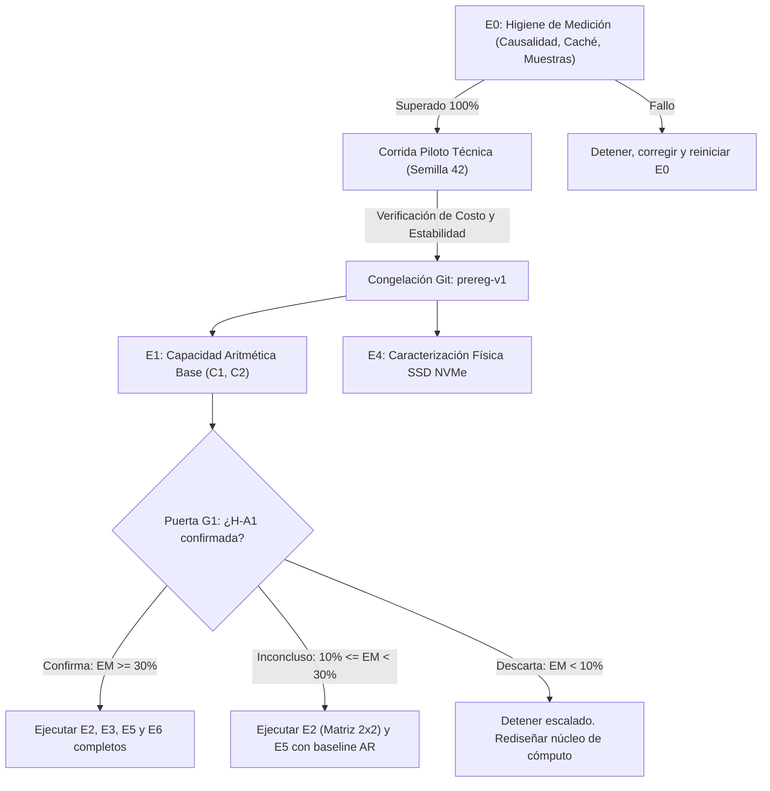

# Protocolo pre-registrado — Basic-Lite (TRDM-v5), Fase 1

**Versión 1.1 · 16 de noviembre de 2026**  
**Autores del protocolo:** Propuesta inicial por Auditor 1; revisión metodológica y correcciones por Auditor 2; consolidación técnica por Miguel19x.  
**Estado:** BORRADOR DE TRABAJO (pre-congelación). Se congelará bajo la etiqueta Git `prereg-v1` tras validar E0 y la corrida piloto técnica.  
**Commit base del repositorio:** `d0a2b8b61efdd47ab705a00f73d6735caccd9034`  
**Entorno de referencia:** Intel Core i3-1115G4 (2C/4T @ 3.00 GHz, 6 MB L3), 16 GB RAM DDR4, SSD NVMe MSI M450 500GB (PCIe Gen4 x4), Linux x86_64.

---

## 1. Propósito, Identidad del Modelo y Reglas de Pre-registro

Este documento fija, con carácter prospectivo y vinculante, las hipótesis, arquitecturas, datos, métricas, baselines y criterios formales de confirmación, refutación o inconclusión para la **Fase 1 de Basic-Lite**. El objetivo metodológico es eliminar el sesgo de interpretación *post-hoc* asegurando que cada resultado se evalúe según reglas decididas antes de observar los datos.

### 1.1 Identidad del Modelo y Alcance de Versión
* **Arquitectura evaluada:** **Basic-Lite (TRDM-v5)**. Modelo recurrente discreto por bloques con cómputo adaptativo, ejecución directa sobre pesos paginados (Paged BitCOS) y enrutamiento disperso MoE consciente de latencia de almacenamiento.
* **Componentes heredados consolidados:** Capas BitLinear W1.58A8 con gradiente en línea recta (STE), normalización RMSNorm, codificación posicional rotatoria (RoPE), codificación sinusoidal continua de profundidad $PE(u_r)$ y atención por bloques causales.
* **Componentes de v5 integrados:** Serialización y lectura alineada a 4 KB (Paged BitCOS v1), kernel C fisionado sobre bloques empaquetados, router MoE con penalización por I/O físico y gestor de contexto en tres niveles.
* **Cambios obligatorios previos a las corridas confirmatorias:**
  1. Adopción estricta del contrato de salida de **ancho fijo** (`watt: 087\nms: 045\n`).
  2. Eliminación de la indexación por recursión en parámetros (los embeddings y escalares dependientes de la profundidad $r$ se eliminan o comparten globalmente para evitar inyectar pesos no entrenados en recursiones superiores).
  3. Eliminación de cualquier oráculo o pista externa sobre longitud de respuesta.
* **Estatus de antecedentes:** Todos los experimentos previos (incluyendo datasets de 480 tuplas, evaluaciones preliminares de 12 lotes de gradientes y suites exploratorias) se clasifican expresamente como **exploratorios**. No constituyen evidencia confirmatoria retroactiva.

### 1.2 Reglas Metodológicas del Pre-registro
1. **Congelación formal (`prereg-v1`):** Al finalizar la revisión y validar la higiene E0, se creará el tag `prereg-v1` en Git conteniendo este documento y el hash SHA-256 de las particiones de datos. A partir de ese momento, ningún umbral ni condición podrá modificarse sin una enmienda formal (§9).
2. **Uso estricto del conjunto de test:** El conjunto `test` permanece cerrado y se abre **únicamente después** de congelar el código de los modelos, fijar los hiperparámetros en `dev` y congelar el pipeline. Se ejecutarán **todas las condiciones de test preespecificadas** en este documento. Queda terminantemente prohibido utilizar los resultados de `test` para ajustar hiperparámetros, reentrenar modelos o alterar la arquitectura.
3. **Reporte íntegro sin selección:** Todo resultado (positivo, nulo, adverso o inconcluso) debe ser reportado. Si un experimento planificado no se ejecuta por razones de cómputo o error de software, se declarará abiertamente la causa.
4. **La unidad estadística es la combinación única:** Dado que la tarea es formal y determinista, evaluar múltiples veces la misma combinación de entrada no incrementa el tamaño muestral efectivo ($N$). Toda referencia a «$N \ge 200$» exige **combinaciones distintas de entrada**.
5. **Alcance limitado a lo medido:** La Fase 1 no valida ni autoriza declaraciones de viabilidad para modelos de 30B, ni comparaciones de inferencia masiva frente a `llama.cpp` o `bitnet.cpp` (reservadas a la Fase 2). Todo veredicto debe acompañarse de su criterio formal.
6. **Regla de decisión tripartita:** Para evitar la confusión entre ausencia de significación estadística y prueba de nulidad, toda evaluación por intervalos de confianza (IC95) adoptará tres estados:
   * **Apoya la hipótesis:** El estimador puntual y el IC95 satisfacen el umbral preestablecido.
   * **Descarta la mejora mínima:** El límite superior del IC95 queda estrictamente por debajo del umbral mínimo de interés.
   * **Inconcluso:** El IC95 cruza el umbral de decisión, impidiendo una conclusión definitiva con la potencia actual.

---

## 2. Alcance de los Experimentos (E0 a E6)

* **E0. Higiene de medición y contratos del sistema:** Verificación obligatoria de causalidad, independencia entre muestras del lote, equivalencia numérica de caché y parsers.
* **E1. Capacidad aritmética de base:** Evaluación del núcleo en la tarea composicional ampliada frente a baselines autorregresivos comparables.
* **E2. Aislamiento de factores (Decodificación vs. Capacidad):** Matriz 2×2 para desacoplar el efecto de la iteración temporal del efecto de la visibilidad de plantilla.
* **E3. Caracterización de gradientes e interferencia multitarea:** Análisis estratificado por nivel de ruido $t$ e intervención con proyección ortogonal (PCGrad).
* **E4. Caracterización física de E/S en almacenamiento:** Barrido empírico de latencia y ancho de banda en SSD NVMe frente a tamaño de bloque y concurrencia.
* **E5. Localidad de enrutamiento en capacidad modular:** Medición de tasa de aciertos y degradación de compresión con presupuesto acotado de módulos residentes.
* **E6. Generalización de profundidad en inferencia:** Evaluación del comportamiento de la recurrencia adaptativa ($R > 2$) eliminando confusores paramétricos.

---

## 3. Especificación de Datos y Particiones

### 3.1 Tarea Sintética v2 (Espacio Combinatorio Ampliado)
Se mantienen las relaciones deterministas de cálculo de potencia y tiempo, pero se expande el espacio combinatorio para superar los límites de potencia estadística:
* **Ejes discretos:** 10 tipos de nodo × 8 perfiles de carga × 6 factores de redundancia × 6 niveles de estrés = **2880 combinaciones distintas**.
* **Contrato de salida de ancho fijo:**
  ```text
  watt: 087\n
  ms: 045\n
  ```
  Cada campo formateado estrictamente a 3 dígitos con ceros a la izquierda y delimitado por salto de línea (`\n`). Un script de validación verificará que ningún valor del dominio excede 999.

### 3.2 Particiones Disjuntas
* **`test-composicional` (evaluación fuerte):** Se reservan 8 pares cruzados `(perfil, estrés)`. Todas las combinaciones que contienen alguno de estos pares quedan absolutamente excluidas de entrenamiento: $8 \times 10 \times 6 = \mathbf{480}$ combinaciones únicas.
* **`test-azar` (evaluación débil / IID):** 10% del remanente seleccionado aleatoriamente ($\approx 240$ combinaciones únicas).
* **`dev` (calibración y selección de muestreador):** $\approx 5\%$ del remanente ($\approx 108$ combinaciones únicas).
* **`train` (entrenamiento):** Todas las combinaciones restantes ($\approx 2052$ combinaciones).

### 3.3 Verificación y Techos Triviales
Antes de iniciar el entrenamiento, un script auditado comprobará la disyunción absoluta de particiones mediante hash SHA-256 por registro.  
Se calcularán los siguientes **predictores triviales de referencia calculados exclusivamente sobre `train`**:
1. **Moda por posición de dígito:** Asignar a cada posición el dígito más frecuente en entrenamiento.
2. **Moda por campo:** Asignar el valor numérico modal de `watt` y `ms`.
3. **Plantilla perfecta + moda:** Plantilla sintáctica fija completada con los dígitos modales.

Toda métrica de exactitud reportada deberá acompañarse obligatoriamente de su respectivo techo trivial.

---

## 4. Modelos, Presupuestos y Comparabilidad

### 4.1 Tabla de Comparabilidad de Modelos

| Dimensión | **M-HIB (TRDM-v5)** | **M-AR-pasos (Baseline AR)** | **M-AR-FLOPs (Baseline FLOPs)** | **M-HIB-variable (Control)** |
| :--- | :---: | :---: | :---: | :---: |
| **Arquitectura** | Recurrente por bloques + Difusión | Transformador Causal Denso | Transformador Causal Denso | Idem M-HIB |
| **Formato de salida** | Ancho fijo (3 dígitos) | Ancho fijo (3 dígitos) | Ancho fijo (3 dígitos) | Longitud variable |
| **Parámetros totales** | $\sim 870\text{k} \pm 10\%$ | $\sim 870\text{k} \pm 10\%$ | $\sim 870\text{k} \pm 10\%$ | $\sim 870\text{k}$ |
| **Entrada** | Bytes canónicos | Bytes canónicos | Bytes canónicos | Bytes canónicos |
| **Supervisión** | Bloques de salida | Token a token causal | Token a token causal | Bloques de salida |
| **Presupuesto base** | 3000 pasos (Lote 16) | 3000 pasos (Lote 16) | Pasos calibrados por FLOPs | 3000 pasos (Lote 16) |
| **FLOPs estimados** | $2 \times \text{Forward} \times R$ | $1 \times \text{Forward}$ | Igualados a M-HIB | Igualados a M-HIB |

### 4.2 Protocolo de Muestreo (Selección en `dev`)
En el conjunto `dev` se evaluarán tres políticas de muestreo para M-HIB, fijando una única variante antes de abrir `test`:
* **D1:** Muestreador actual por difusión discreta (4 rondas, remasking por coseno).
* **D2:** Desenmascaramiento progresivo ordenado por confianza (1 token por paso).
* **D3:** Desenmascaramiento progresivo ordenado por confianza (2 tokens por paso).

---

## 5. Protocolo Detallado de Experimentos

### E0. Higiene de Medición y Contratos del Sistema (Puerta de Entrada)
*Criterio:* Todas las pruebas deben superarse de forma estricta. Si alguna falla, se detiene la fase, se corrige el código y se repite la suite completa documentando el incidente.

* **E0.1 Causalidad temporal diferenciable:**  
  Para todo bloque temporal $i$ y todo bloque $j > i$, el gradiente de los logits del bloque $i$ respecto a la representación continua de entrada del bloque $j$ debe ser idénticamente nulo:
  $$\frac{\partial \text{logits}_i}{\partial x_{\text{embed}, j}} = 0 \quad (\le 10^{-9})$$
  Comprobado tanto en modo `train` como en modo `eval`.
* **E0.2 Equivalencia numérica de caché:**  
  La diferencia absoluta máxima en logits entre la inferencia incremental bloque a bloque con KV-Cache y el recálculo paralelo completo debe satisfacer $\max |\Delta \text{logits}| \le 10^{-4}$ en precisión FP32, evaluado sobre lotes de 1, 4 y 8 muestras.
* **E0.3 Independencia estricta entre muestras:**  
  Fijando la semilla del generador pseudoaleatorio (para aislar efectos estocásticos de dropout), los logits generados para la muestra $k$ deben permanecer invariantes ($\le 10^{-5}$) independientemente de qué otras muestras conformen el lote.
* **E0.4 Integridad de analizadores y formato:**  
  Prueba de ida y vuelta determinista de codificación UTF-8 y del parser sintáctico de campos de ancho fijo sobre el 100% de las 2880 combinaciones.
* **E0.5 Validación criptográfica de datos:**  
  Comprobación de disyunción de conjuntos (`train` $\cap$ `test-comp` $= \emptyset$) y cálculo formal de techos triviales.

---

### E1. Capacidad Aritmética Fundamental (H-A1, H-A2, H-B1)
* **Condiciones de Inferencia:**
  * **C1:** Inferencia en una sola pasada con todo el bloque objetivo enmascarado ($t = 1.0$).
  * **C2:** Generación libre de extremo a extremo mediante el muestreador seleccionado en `dev`.
* **Métrica primaria:** Exact Match (EM) conjunto estricto (`watt` Y `ms` correctos) en C2 sobre `test-composicional`.
* **Métricas secundarias:** EM por campo aislado; exactitud por dígito en C1; EM en `test-azar`; EM sobre muestra de entrenamiento ($N=200$).

#### Hipótesis y Criterios de Decisión:
* **H-A1 (Aprendizaje de la tarea por el núcleo):**
  * *Confirma:* Límite inferior del IC95 de EM(C2, composicional) $\ge 30\%$ Y exactitud de dígitos en C1 $\ge \text{techo trivial} + 15$ puntos.
  * *Descarta:* Límite superior del IC95 de EM(C2, composicional) $< 10\%$ tras 3000 pasos.
  * *Inconcluso:* El IC95 se sitúa entre $10\%$ y $30\%$.
* **H-A2 (No inferioridad frente al transformer autorregresivo):**
  * Margen de no inferioridad prefijado en $\Delta = -10$ puntos de EM en C2 frente a M-AR-FLOPs.
  * *No inferioridad apoyada:* Límite inferior del IC95 de $(\text{EM}_{\text{HIB}} - \text{EM}_{\text{AR}}) > -10$ puntos.
  * *Inferioridad sustancial:* Límite superior del IC95 $< -10$ puntos.
  * *Inconcluso:* El IC95 cruza $-10$ puntos.
* **H-B1 (Efecto del contrato de ancho fijo):**
  * *Confirma:* Límite inferior del IC95 de $(\text{EM}_{\text{fijo}} - \text{EM}_{\text{variable}}) \ge +10$ puntos.
  * *Descarta mejora relevante:* Límite superior del IC95 $< +3$ puntos.
  * *Inconcluso:* El intervalo cruza el umbral de $+3$ o incluye el 0.

---

### E2. Aislamiento Causal: Decodificación frente a Estructura
Para desacoplar formalmente si los errores proceden de la dificultad de cálculo, de la pérdida de formato o de la acumulación de ruido iterativo, se ejecuta una **matriz factorial 2×2**:

| Estructura \ Dinámica | **Inferencia en 1 Pasada** | **Inferencia Iterativa (Muestreador)** |
| :--- | :---: | :---: |
| **Plantilla Oculta (Sin pistas)** | **Condición A** (C1 estándar) | **Condición B** (C2 libre estándar) |
| **Plantilla Visible (Asistida)** | **Condición C** (Solo dígitos libres) | **Condición D** (Iteración con plantilla fija) |

#### Desacoplamiento de Factores:
* **Efecto neto de la iteración:** Comparación $(\text{EM}_B - \text{EM}_A)$ sobre plantilla oculta.
* **Efecto neto de la estructura de plantilla:** Comparación $(\text{EM}_C - \text{EM}_A)$ en una sola pasada.
* **Interacción estructura-iteración:** Comparación $(\text{EM}_D - \text{EM}_B)$.
* **Criterio de diagnóstico:**
  * Si $\text{EM}_C \ge 60\%$ y $\text{EM}_B$ está $\ge 30$ puntos por debajo: el fallo reside primariamente en el control de alineamiento y delimitadores.
  * Si $\text{EM}_C < 30\%$: el núcleo presenta incapacidad aritmética intrínseca independientemente de la estabilidad de formato.
  * Rangos intermedios: se reportan formalmente como error compuesto mixto.

---

### E3. Caracterización de Gradientes e Interferencia Multitarea
*(Aplicable si se mantiene supervisión sobre subtotales/scratchpad)*

#### Caracterización Formal:
* Evaluación en checkpoints al **10%, 50% y 100%** del entrenamiento.
* Estratificación factorial por nivel de ruido: $t \in \{0.25, 0.50, 0.75, 1.00\}$.
* **Tamaño muestral:** $\ge 300$ lotes **independientes y distintos** por celda.
* **Grupos de parámetros aislados:** Embeddings/Cabeza, Núcleo Recurrente, Normalizaciones.
* **Gradientes nulos:** Si para un lote $\nabla L_i = 0$, el coseno se registra como indefinido, reportando la frecuencia de ocurrencia sin computarlo como cero arbitrario.
* Se registrarán los gradientes de la entropía cruzada pura **no ponderada** y la razón de normas $\|\nabla L_{\text{intermedio}}\| / \|\nabla L_{\text{final}}\|$.
* **Control de ruido:** Medición del coseno entre dos minilotes disjuntos de la misma pérdida final para establecer el piso empírico de dispersión estocástica.

#### Intervención Controlada:
Se evalúan 3 brazos (5 semillas cada uno):
1. **Control:** Suma estándar de pérdidas ($L = L_{\text{inter}} + L_{\text{final}}$).
2. **Reponderación:** Atenuación del objetivo intermedio ($L = 0.25 L_{\text{inter}} + L_{\text{final}}$).
3. **PCGrad:** Proyección ortogonal de gradientes cuando $\langle \nabla L_{\text{inter}}, \nabla L_{\text{final}} \rangle < 0$.
* **H-C:** Se concluye que la interferencia de gradientes perjudicaba el desempeño si al menos una intervención supera al control en $\ge +5$ puntos de EM en C2 con corrección de Holm ($\alpha = 0.05$). De lo contrario, se descarta formalmente la hipótesis de interferencia destructiva.

---

### E4. Caracterización Física de E/S en Almacenamiento NVMe
* **Registro de hardware:** SSD NVMe MSI M450 500GB (Gen4 x4), Intel Core i3-1115G4, Linux 6.x.
* **Archivo de prueba:** Archivo binario continuo de 8 GiB generado con `/dev/urandom` sobre el sistema de archivos del sistema.
* **Matriz de factores:**
  * Tamaños de lectura por solicitud: 256 KiB, 512 KiB, 1 MiB, 4 MiB, 16 MiB, 64 MiB y 256 MiB.
  * Concurrencia de hilos: 1, 4, 8 y 32 hilos.
  * Interfaces del sistema: `pread(2)`, `O_DIRECT` y `mmap(2)` con llamadas `madvise`.
* **Validación estricta de lectura en frío:**  
  En cada iteración, se verifica que el incremento en `read_bytes` de `/proc/self/io` dividido entre los bytes solicitados se sitúe en el rango $[0.95, 1.10]$. Si la llamada es atendida por la Page Cache del kernel, la repetición queda invalidada.
* **H-E1 (Sensibilidad a tamaño de transferencia):**
  * *Confirma sensibilidad:* El rendimiento (GB/s) con transferencias $\ge 4$ MiB o concurrencia $\ge 8$ es $\ge 3\times$ superior al obtenido con 512 KiB a cola 1.
  * *Descarta:* La mejora es $< 1.5\times$.
  * *Interpretación:* Este experimento determina la curva de costo de transferencia por módulo; no se extrapola a otros discos ni patrones de acceso.

---

### E5. Localidad de Enrutamiento en Capacidad Modular (MoE Paginado)
* **Objetivo:** Determinar si un modelo con $K=16$ módulos especializados puede operar con $M \in \{2, 4, 8\}$ módulos residentes bajo enrutamiento con penalización de memoria.
* **Datos:** Texto a nivel de bytes en 3 dominios abiertos (prosa español, prosa inglés, código fuente), particionado por documentos sin solapamiento ($\ge 10$ MB por dominio).
* **Modelos comparados:**
  * **R0:** Denso de control con parámetros activos iguales.
  * **R1:** MoE estándar con enrutamiento por token (Top-2) sin consideración de residencia.
  * **R2:** MoE por bloques (16 tokens) sin penalización de transferencia.
  * **R3:** MoE por bloques con penalización de reemplazo de módulo en memoria.
* **Selección previa en `dev`:** La cuadrícula de penalización $\lambda \in \{0.01, 0.1, 1.0\}$ se calibra exclusivamente sobre `dev`.
* **H-E5:** Con $M/K = 25\%$ ($M=4$), R3 alcanza una tasa de aciertos de caché $\ge 80\%$ con una degradación de bpb $\le 3\%$ **relativa** a R2 con todos los módulos residentes ($M=K$).

---

### E6. Generalización de Profundidad en Inferencia
* **Corrección previa:** Se eliminan todas las tablas de parámetros indexadas por el entero $r$. Las recursiones comparten estrictamente las mismas matrices y modulaciones normalizadas.
* **Diseño:** Dos brazos de entrenamiento (R=2 fijo vs. R variable en $\{1, 2, 3\}$). Evaluación en inferencia para $R \in \{1, 2, 3, 4, 6, 8\}$ sobre `test-composicional`.
* **H-E6:** En el brazo entrenado a R=2, $\text{EM}(R=4) - \text{EM}(R=2) \ge +5$ puntos con límite inferior del IC95 $> 0$.
* **Declaración epistemológica:** La eliminación de confusores garantiza que no se inyectan parámetros aleatorios; la prueba evalúa si la dinámica latente recurrente generaliza fuera de distribución a mayor profundidad.

---

## 6. Procedimiento Estadístico y Control de Errores

* **Número de semillas:** 5 semillas independientes (42, 43, 44, 45, 46) para las corridas confirmatorias finales.
* **Estimación de incertidumbre:** Intervalos de confianza al 95% mediante **bootstrap por conglomerados** (remuestreando pares semilla-ejemplo con 10,000 repeticiones). Proporciones puntuales mediante intervalos de Wilson.
* **Comparaciones pareadas:** Bootstrap pareado sobre las mismas combinaciones de entrada y las mismas semillas.
* **Ajuste por comparaciones múltiples:** Corrección de **Holm-Bonferroni** dentro de cada familia experimental con tasa de error familiar $\alpha = 0.05$.
* **Sin detención anticipada:** El número de pasos y de semillas fijado en el protocolo no se interrumpirá antes de término bajo ninguna circunstancia.

---

## 7. Árbol de Dependencias y Puertas de Ejecución



---

## 8. Formato Obligatorio de Reporte

Cada reporte experimental deberá registrarse en un archivo estructurado bajo la siguiente plantilla estándar:

> **[Experimento] [Condición]:**  
> * **Métrica primaria:** Estimador puntual (IC95 [Límite inferior, Límite superior]; Semillas = 5; $N_{\text{único}} = \text{Ítems distintos}$).  
> * **Techo trivial de referencia:** Valor numérico en `train`.  
> * **Diferencia frente a baseline:** $\Delta$ vs. Referencia (IC95 [Límite inferior, Límite superior]; $p$-valor ajustado por Holm).  
> * **Veredicto formal según protocolo:** [APOYA LA HIPÓTESIS | DESCARTA MEJORA RELEVANTE | INCONCLUSO].  
> * **Telemetría de entorno:** Commit Git exacto, tiempo CPU medido, pico RSS en MiB y bytes físicos leídos (`read_bytes`).

---

## 9. Protocolo de Registro y Enmiendas

1. El borrador actual se consolida en el repositorio y en el Escritorio.
2. Tras superar la suite E0 y la corrida técnica preliminar, se etiquetará el commit correspondiente con la etiqueta inmutable `prereg-v1`.
3. Cualquier modificación posterior requerirá la creación del archivo `ENMIENDAS.md`, indicando fecha, justificación técnica, naturaleza del cambio y declarando expresamente si ya se habían observado datos de evaluación.
4. Todo resultado obtenido mediante una regla modificada tras observar datos perderá la categoría de confirmatorio y se reportará obligatoriamente como **exploratorio**.
