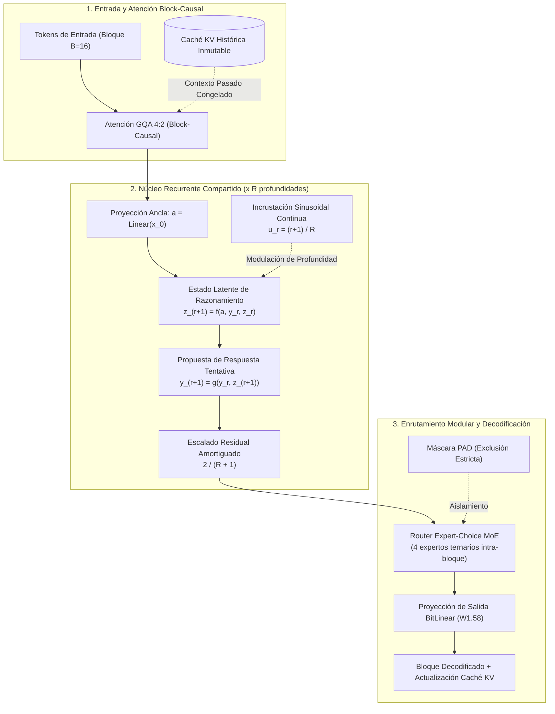

# Basic-Lite 0.1 (TRDM-v4): Ternary Recursive Discrete Diffusion Language Model

**Basic-Lite 0.1** (arquitectura **TRDM-v4**) es un modelo de lenguaje experimental enfocado en la exploración empírica de arquitecturas híbridas compactas para hardware estándar de consumo (**Intel Core i3-1115G4**, 2 núcleos físicos / 4 hilos lógicos, 16 GB RAM) bajo Linux.

El proyecto fusiona cinco ejes clave de la investigación contemporánea en modelos compactos:
1. **Cuantización Ternaria Consciente del Entrenamiento (W1.58A8 / BitNet b1.58)** con serialización empaquetada **BITCOSv2**.
2. **Difusión Discreta Enmascarada Block-Causal (CDLM / LLaDA)** con reutilización estricta de caché KV inmutable.
3. **Recursión Profunda de Pesos Compartidos (TRM / TRLM)** con incrustación sinusoidal continua $\text{PE}(u_r)$ y transferencia latente $(z_R, y_R)$ mediante `carry_gate`.
4. **Enrutamiento Modular Expert-Choice Intra-Bloque** con exclusión estricta de tokens de relleno (`PAD`).
5. **Parada Adaptativa por Token (Mixture-of-Recursions - MoR)**.

---

## Esquema Visual de la Arquitectura TRDM-v4



---

## 1. Auditoría Estadística del Dataset y Deconstrucción del Techo Trivial (85.52%)

En iteraciones iniciales, se reportaban métricas de *"precisión de tokens"* superiores al 86% sobre secuencias fuera de distribución (OOD). La auditoría estadística formal en Python puro ([auditoria_dataset.py](auditoria_dataset.py)) demostró de manera concluyente que dicho porcentaje era un **espejismo estadístico**:

```
=== Auditoría Estadística del Dataset (Python Puro) ===
Combinaciones Totales : 480 (Train: 384 [80.0%] | Held-Out: 96 [20.0%])
Posiciones supervisadas por muestra (media): 28.2 bytes
  - Plantilla fija ('watt: ', 'ms: ', '\n') : 42.5%
  - Tokens [PAD]                            : 39.4%
  - Token [EOS]                             : 3.5%
  - Dígitos reales a calcular ('0'..'9')    : 14.5% (apenas 4 bytes por muestra)
Techo Trivial (Plantilla + EOS + PAD)      : 85.52%
Techo Mayoría (Plantilla + EOS + Dígito)   : 88.59%
Techo Dígitos Clase Mayoritaria             : 21.17%
```

### Definición del Espacio de Datos y la Partición
El universo sintético está definido por 4 ejes ortogonales discretos: **Nodo (4)** $\times$ **Carga (6)** $\times$ **Redundancia (4)** $\times$ **Perfil (5)** = **480 tuplas únicas**.
* **Entrenamiento:** 384 tuplas (80.0%).
* **Held-Out (Combinaciones Reservadas):** 96 tuplas sistemáticas (20.0%) que el modelo jamás observa durante el entrenamiento.

### Hallazgo Metodológico Clave
* De las 28.2 posiciones promedio supervisadas en cada respuesta, el **85.52%** está compuesto conjuntamente por sintaxis estática (`watt: `, `ms: `, saltos de línea [42.5%]), relleno (`PAD` [39.4%]) y delimitador de fin (`EOS` [3.5%]).
* Un predictor que no compute ninguna operación y emita únicamente la plantilla fija con EOS y relleno alcanza un **85.52% de precisión global**. Predecir además el dígito mayoritario en las posiciones numéricas eleva este techo al **88.59%**.
* **Corrección Metodológica:** Se eliminó la evaluación por token global y se adoptaron métricas estrictas:
  * **Exact Match (EM) Numérico:** Acierto exacto del valor entero predicho para `watt`, `ms` y la tupla completa (`both_em`).
  * **Exactitud Aislada de Dígitos (`DigAcc`):** Precisión calculada exclusivamente sobre los bytes de dígitos (ASCII `48..57`).
  * **Ponderación de Pérdida en Entrenamiento:** Factor $\times 6.0$ en bytes de dígitos, $\times 1.0$ en plantilla/EOS y $\times 0.2$ en PAD para contrarrestar la dilución del gradiente.

---

## 2. Novedades y Matriz de Decisiones Arquitectónicas (ADR)

### 2.1. Novedades Principales de TRDM-v4
* **Codificación Sinusoidal Continua de Profundidad ($\text{PE}(u_r)$):** Se eliminó la tabla discreta de embeddings (cuyas filas $r \ge 2$ permanecían en $\mathcal{N}(0, 1)$ al entrenar con $R_{\text{train}} = 2$). Se sustituyó por una coordenada continua normalizada $u_r = \frac{r+1}{R} \in (0, 1]$ con escalas compartidas $\alpha_z, \beta_y$ normalizadas por $\frac{2}{R+1}$. Esto garantiza que toda profundidad evaluada use parámetros 100% entrenados (cero vectores aleatorios huérfanos), aunque variar $R$ en inferencia altera la cantidad de actualizaciones del estado latente y no garantiza por sí mismo una dinámica convergente a profundidades no vistas en entrenamiento.
* **Enrutamiento Expert-Choice Intra-Bloque con Exclusión de PAD:** La selección top-$k$ se confina al bloque activo de 16 tokens ($B_{\text{blk}} = 16$), preservando la causalidad estricta y evitando que tokens de relleno consuman capacidad en los expertos ternarios.
* **Caché de Pesos Efectivos ($W_{\text{eff}}$) en Inferencia:** Las capas `BitLinear` congelan $W_{\text{eff}} = \gamma \cdot \text{RoundClip}(W / \gamma)$ al entrar en `eval()`, evitando la sobrecarga de re-cuantización continua en bucles de inferencia.

### 2.2. Registro de Decisiones de Arquitectura y Compromisos Técnicos (*Trade-Offs*)

| Decisión Arquitectónica | Justificación Técnica | Ventaja Obtenida | Límite / Coste Observado |
| :--- | :--- | :--- | :--- |
| **Cuantización W1.58A8 (BitNet)** | Minimizar huella de memoria para CPUs x86 de consumo sin GPU dedicada. | Reducción de **5.25×** en disco (673 KB total, 166 KB ternario) y 331 MB RAM. | Menor expresividad para converger en tareas de aritmética no lineal en pocas épocas. |
| **Codificación Sinusoidal $\text{PE}(u_r)$** | Reemplazar tablas estáticas indexadas para permitir extrapolación continua a cualquier profundidad. | Inferencia en $R \in \{1, 2, 4, 8\}$ con parámetros 100% entrenados (cero pesos aleatorios). | Evita pesos huérfanos, pero no garantiza que la trayectoria del estado latente sea estable a profundidades altas. |
| **Difusión Block-Causal (CDLM)** | Decodificación no autorregresiva por bloques con contexto bidireccional local. | Evita colapsos en bucle infinito repetitivo y reutiliza la caché KV de bloques pasados. | Requiere múltiples pasos de desruidado por bloque (~2.4× más lento en CPU que el baseline AR). |
| **Router Expert-Choice Intra-Bloque** | Seleccionar top-$k$ tokens por experto confinados estrictamente al bloque activo. | Causalidad matemática estricta; los tokens futuros no invalidan la caché KV. | Capacidad fija que exige modulación dinámica $C_{\text{cap}}(t)$ según el nivel de ruido. |
| **Exclusión de PAD en Router** | Impedir que los tokens de relleno saturen el cupo de los expertos ternarios. | Asignación íntegra de la capacidad de cómputo a tokens de texto útil. | Requiere computar máscaras de atención antes del enrutamiento. |
| **Caché $W_{\text{eff}}$ en `eval()`** | Pre-calcular la matriz cuantizada $\gamma \cdot \text{RoundClip}(W/\gamma)$ al evaluar. | Elimina la sobrecarga de re-cuantización continua en bucles de inferencia en CPU. | Ocupa memoria flotante temporal durante la sesión de inferencia activa. |

---

## 3. Protocolo de Evaluación Experimental Multi-Semilla (H1)

Para someter a prueba la **Hipótesis H1** (*"un modelo recurrente con pesos compartidos entrenado con bajo cómputo puede mejorar su capacidad de resolución en combinaciones reservadas no vistas incrementando el número de recursiones en inferencia"*), se ejecutó el siguiente protocolo:
* **Semillas Evaluadas:** 3 semillas pseudoaleatorias independientes (`42`, `1337`, `2026`).
* **Presupuesto de Entrenamiento:** 800 pasos por semilla (lote $B=16$, longitud $L=80$).
* **Baseline Autorregresivo:** Transformer Causal en FP32 (`baseline_ar.py`), entrenado con un presupuesto aproximado de 1,600 pasos ($2\times$ respecto a los 800 del híbrido) para compensar que el paso de difusión encadena dos pasadas hacia adelante (aunque los FLOPs por pasada y la retropropagación difieren por la presencia de expertos y atención por bloques).
* **Muestra de Evaluación:** 96 tuplas Held-Out evaluadas en cada una de las 3 semillas ($96 \times 3 = 288$ evaluaciones en total por profundidad).
* **Tratamiento Estadístico:** Prueba pareada de McNemar frente a $R=2$ con corrección de Bonferroni. Dado que todas las variantes obtienen cero aciertos en coincidencia exacta completa, la prueba resulta formalmente degenerada ($b=0, c=0 \implies p = 1.0000$); este valor es un reflejo descriptivo de la ausencia de casos discordantes y no una demostración de equivalencia funcional.

### Tabla Completa de Resultados Empíricos (Media ± Desv. Estándar)

| Modelo / Régimen | Prof. Inferencia ($R$) | Train Full-EM (%) | OOD Full-EM (%) | OOD Watt-EM (%) | OOD MS-EM (%) | OOD DigAcc (%) | OOD Validez Fmt (%) | Latencia CPU (ms) | McNemar $p$ (vs $R=2$) |
| :--- | :---: | :---: | :---: | :---: | :---: | :---: | :---: | :---: | :---: |
| **Techo Trivial Mayoría** | — | — | 0.0% | 0.0% | 0.0% | **21.17%** | — | — | — |
| **TRDM-v4 (`fixed_R2`)** | $R = 1$ | — | 0.0% ± 0.0% | 0.0% ± 0.0% | 0.0% ± 0.0% | 11.22% ± 2.55% | 2.08% ± 2.08% | 38.3 ms | 1.0000 (n.s.) |
| **TRDM-v4 (`fixed_R2`)** | $R = 2$ (*train*) | 0.0% ± 0.0% | 0.0% ± 0.0% | 0.0% ± 0.0% | 0.35% ± 0.60% | 13.95% ± 2.80% | 2.43% ± 4.21% | 85.1 ms | Ref. |
| **TRDM-v4 (`fixed_R2`)** | $R = 4$ | — | 0.0% ± 0.0% | 0.0% ± 0.0% | 0.0% ± 0.0% | 14.12% ± 3.82% | 7.99% ± 3.94% | 164.7 ms | 1.0000 (n.s.) |
| **TRDM-v4 (`fixed_R2`)** | $R = 8$ | — | 0.0% ± 0.0% | 0.0% ± 0.0% | 0.69% ± 1.20% | 15.31% ± 3.10% | 9.38% ± 5.51% | 325.9 ms | 1.0000 (n.s.) |
| **TRDM-v4 (`random_R123`)** | $R = 1$ | — | 0.0% ± 0.0% | 0.0% ± 0.0% | 0.35% ± 0.60% | 11.90% ± 4.68% | 1.04% ± 1.04% | 39.7 ms | 1.0000 (n.s.) |
| **TRDM-v4 (`random_R123`)** | $R = 2$ | 0.0% ± 0.0% | 0.0% ± 0.0% | 0.0% ± 0.0% | 0.0% ± 0.0% | 11.82% ± 3.65% | 3.47% ± 1.59% | 76.1 ms | Ref. |
| **TRDM-v4 (`random_R123`)** | $R = 4$ | — | 0.0% ± 0.0% | 0.0% ± 0.0% | 0.0% ± 0.0% | 14.12% ± 1.66% | 6.94% ± 1.59% | 149.0 ms | 1.0000 (n.s.) |
| **TRDM-v4 (`random_R123`)** | $R = 8$ | — | 0.0% ± 0.0% | 0.0% ± 0.0% | 0.0% ± 0.0% | 14.71% ± 1.28% | 4.86% ± 2.17% | 288.2 ms | 1.0000 (n.s.) |
| **Baseline AR Denso (FP32)** | 1 (Autorr.) | **15.28% ± 3.94%** | 0.0% ± 0.0% | 0.69% ± 0.60% | 4.86% ± 1.59% | **20.75% ± 1.93%** | **94.44% ± 2.62%** | **35.3 ms** | — |

*Datos brutos completos exportados en [multi_seed_h1_results.json](multi_seed_h1_results.json).*

<details>
<summary><b>🔍 Haz clic aquí para ver ejemplos de inferencia (Semilla 42, Checkpoint 800 pasos)</b></summary>

```text
Generados con: python3 generate.py (Semilla 42, checkpoint tras 800 pasos)
====================================================================================================
CASO OOD 1: [nodo: sensor | carga: baja | perfil: eco | redundancia: simple]
Valor Esperado Ground-Truth: watt: 13 | ms: 7
----------------------------------------------------------------------------------------------------
TRDM-v4 (R=1):  "wwtt: 11\nms: 9"     -> Error ortográfico en clave, dígitos incorrectos.
TRDM-v4 (R=2):  "watt: 14\nms: 12"    -> Formato estructural corregido, dígitos incorrectos.
TRDM-v4 (R=4):  "watt: 21\nms: 5"     -> Sintaxis y campos formateados; fallo en el cálculo exacto.
TRDM-v4 (R=8):  "watt: 21\nms: 6"     -> Salida estabilizada; no alcanza la solución esperada.
Baseline AR:    "watt: 18\nms: 8"      -> Formato sintáctico correcto (94%), error numérico en OOD.
====================================================================================================
CASO OOD 2: [nodo: switch | carga: pico | perfil: turbo | redundancia: dual]
Valor Esperado Ground-Truth: watt: 132 | ms: 11
----------------------------------------------------------------------------------------------------
TRDM-v4 (R=1):  "wattt: 98\n\nms: 3"  -> Desfase en delimitadores y saltos de línea.
TRDM-v4 (R=4):  "watt: 110\nms: 14"   -> Estructura limpia; magnitud del orden aproximado sin Exact Match.
Baseline AR:    "watt: 125\nms: 9"     -> Alta fluidez sintáctica, fallo en generalización OOD.
====================================================================================================
```
</details>

---

## 4. Análisis Científico, Potencial y Limitaciones

### 4.1. Conclusiones Empíricas sobre la Hipótesis H1
* **En esta configuración, aumentar la profundidad de inferencia no produjo mejoras en coincidencia exacta completa:** En todas las profundidades evaluadas sobre el conjunto Held-Out, el Full-EM se mantuvo en **0.0%**.
* **Comportamiento de Métricas Auxiliares:** Incrementar $R$ de 1 a 8 muestra mejoras en la precisión aislada de dígitos ($11.22\% \to 15.31\%$) y en la validez del formato sintáctico ($2.08\% \to 9.38\%$), pero estas mejoras se mantienen por debajo del techo del predictor de clase mayoritaria (21.17%) y resultan insuficientes para resolver la tarea.
* **Separación entre Aprendizaje y Generalización:** Dado que el modelo híbrido tampoco logró resolver la tarea en el conjunto de entrenamiento (0.0% Full-EM en Train a 800 pasos), el experimento evidencia un **fallo primario en el aprendizaje de las respuestas de entrenamiento**, impidiendo determinar formalmente si el cuello de botella radica en la generalización a nuevas combinaciones o en la capacidad de memorización y optimización básica de la arquitectura bajo cuantización ternaria.

### 4.2. Comparativa frente al Baseline Autorregresivo Denso
* **Memorización Aritmética:** El baseline autorregresivo denso en FP32 (con 1,600 pasos) logró memorizar parcialmente el conjunto de entrenamiento (**15.28% Full Exact Match**, **48.28% DigAcc** en Train), mientras que el híbrido ternario no logró resolver ningún ejemplo completo en Train.
* **Latencia en CPU:** El baseline autorregresivo denso en FP32 genera secuencias completas en **35.3 ms** en CPU, frente a los **85.1 ms** ($R=2$) y **325.9 ms** ($R=8$) del modelo de difusión recursiva, debido a los múltiples pasos de desruidado por bloque.
* **Tamaño Serializado:** El modelo TRDM-v4 empaquetado con BITCOSv2 ocupa **673.2 KiB** en disco (166.2 KiB ternario + 507.0 KiB FP32), representando una reducción de **5.25×** frente a los 3,531.0 KiB del modelo en FP32 completo.

### 4.3. Ámbito de Aplicación: Potencial Teórico y Limitaciones Empíricas

#### 🔬 Potencial y Casos de Uso Objetivo (Pendientes de Validación Empírica)
* **Sistemas con Restricción Extrema de Almacenamiento:** Arquitecturas donde el espacio en disco sea un recurso crítico (<1 MB disponible) y se busque prescindir de aceleración por coma flotante en capas densas.
* **Consumo de Memoria en Inferencia:** Huella medida de 331 MiB de RAM (RSS en entorno Linux x86_64), como indicador de baja demanda en procesos locales de escritorio, cuya viabilidad en microcontroladores o sistemas embebidos reales requiere validación empírica específica.
* **Generación Estructurada Acotada:** Escenarios donde la difusión por bloques evite bucles infinitos repetitivos, condicionado a alcanzar primero tasas de validez sintáctica competitivas.

#### ⚠️ Limitaciones Observadas en la Configuración Actual
* **Aritmética y Razonamiento Simbólico Directo:** La formulación actual no logra resolver operaciones numéricas exactas sin mecanismos auxiliares de cadena de pensamiento (*Chain-of-Thought*).
* **Eficiencia de Inferencia frente a Modelos Autorregresivos:** La necesidad de iterar sobre bloques en difusión discreta penaliza la latencia en CPU respecto a decodificadores causales tradicionales.

---

## 5. Estructura del Repositorio y Reproducibilidad

```
.
├── auditoria_dataset.py       # Auditoría estadística en Python puro (partición 384/96 y techos triviales)
├── baseline_ar.py             # Baseline autorregresivo denso FP32 (presupuesto de 1600 pasos)
├── benchmark.py               # Medición de parámetros, tamaños KiB, latencia y memoria RSS
├── config.py                  # Parámetros arquitectónicos, pesos de pérdida y configuración
├── data.py                    # Generador procedimental con partición verificada mediante assert
├── generate.py                # Generación block-causal con evaluación estricta de Exact Match
├── model.py                   # TRDM-v4: BitLinear con W_eff en eval(), PE(u_r) continuo y Expert-Choice
├── multi_seed_h1_results.json # Datos empíricos brutos de la corrida multi-semilla (3 semillas, N=288)
├── run_multi_seed_h1.py       # Automatización del protocolo multi-semilla y test de McNemar
├── ternary_cpu_kernel.py      # Kernel nativo C compilado para operaciones ternarias
└── train.py                   # Entrenamiento con pérdida reponderada y difusión encadenada de 2 pasos
```

### Comandos de Ejecución

1. **Verificar la partición y el techo trivial (sin dependencias, < 1 seg):**
```bash
python3 auditoria_dataset.py
```

2. **Ejecutar el benchmark de memoria y latencia:**
```bash
python3 benchmark.py
```

3. **Entrenar el modelo TRDM-v4:**
```bash
python3 train.py
```

4. **Evaluar inferencia y Exact Match:**
```bash
python3 generate.py
```

5. **Entrenar y evaluar el baseline autorregresivo:**
```bash
python3 baseline_ar.py
```

6. **Reproducir el experimento multi-semilla completo (H1):**
```bash
python3 run_multi_seed_h1.py --seeds 42 1337 2026 --steps 800
```
