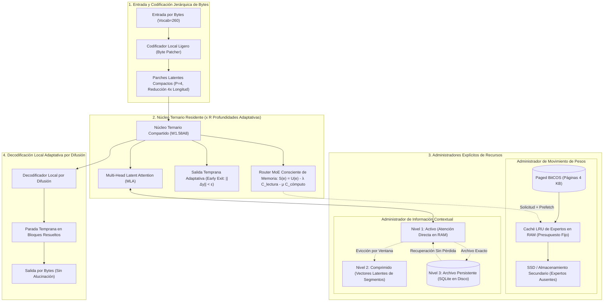

# Basic-Lite 0.2 (TRDM-v5): Motor de Ejecución y Residencia Selectiva para Modelos 30B en Hardware de Consumo

**Basic-Lite 0.2** (arquitectura **TRDM-v5**) representa la evolución arquitectónica de **Basic-Lite 0.1** orientada por el dictamen de auditoría técnica. Su objetivo fundamental es **desarrollar una arquitectura y un motor de ejecución capaces de operar modelos de escala 30B con presupuestos reducidos de RAM y ventanas de contexto masivas** sobre hardware estándar de consumo (**Intel Core i3-1115G4**, 2 núcleos físicos / 4 hilos, 16 GB RAM, Linux).

El principio rector del sistema abandona la premisa de que una única técnica de compresión puede resolver simultáneamente la memoria de parámetros, la ventana de contexto y la latencia. En su lugar, implementa una estrategia coordinada de **residencia y ejecución selectivas**: almacenar masiva capacidad, mantener activa solo una fracción mínima en cada paso y recuperar lo necesario sin degradar la precisión.

---

## Esquema Visual de la Arquitectura TRDM-v5



---

## 1. El Presupuesto Real de Ejecución (Dictamen de Auditoría)

El presupuesto total de memoria en tiempo de ejecución está gobernado por:
$$M_{\text{total}} = M_{\text{pesos residentes}} + M_{\text{contexto}} + M_{\text{trabajo}} + M_{\text{runtime}}$$

Acompañado de dos restricciones dinámicas fundamentales:
* **Volumen transferido:** Bytes que es necesario mover desde almacenamiento secundario por cada paso de inferencia.
* **Tasa de transferencia física:** $t_{\text{lectura}} \ge \frac{D}{B}$ (p. ej., leer 6 GB a 2 GB/s en un SSD NVMe de consumo exige un mínimo teórico de 3 segundos, demostrando que «mover todo desde SSD» es inviable sin selectividad).

### Presupuesto de Almacenamiento para un Modelo de 30B Parámetros

| Representación | Bits / Peso | Tamaño Estimado de Matrices (30B) | Viabilidad en Consumo (16 GB RAM) |
| :--- | :---: | :---: | :--- |
| **FP16 / BF16** | 16 bits | 60.0 GB | Inviable (excede RAM total) |
| **INT8** | 8 bits | 30.0 GB | Inviable en RAM |
| **INT4** | 4 bits | 15.0 GB | Límite crítico (sin espacio para contexto) |
| **INT2** | 2 bits | 7.5 GB | Requiere paginación activa |
| **Ternaria (W1.58 / BITCOS)** | $\log_2 3 \approx 1.58$ bits | **~5.94 GB** | **Totalmente viable con paginación modular** |

---

## 2. Los Cinco Ejes Arquitectónicos de TRDM-v5

### 2.1. Eje 1: Ejecución de Pesos Comprimidos por Páginas (Paged BitCOS)
* **Principio:** Consumir bloques empaquetados directamente en acumuladores sin inflar el modelo completo a FP32 en RAM.
* **Formato Paged BitCOS v1 ([trdm/serialization/paged_bitcos.py](trdm/serialization/paged_bitcos.py)):**
  * Cabecera alineada y tabla de metadatos.
  * Índice de tensores con lista de páginas asociadas.
  * Embeddings y normalizaciones (residentes continuos en RAM).
  * Páginas de matrices ternarias alineadas estrictamente a **4096 bytes** (4 KB).
  * Índice de expertos para lectura selectiva e independiente sin reconstruir matrices completas.
* **Formatos de Empaquetado:**
  * `compact`: Bit de presencia + bit de signo para pesos no nulos (mínimo tráfico de almacenamiento).
  * `fast`: Empaquetado directo de 2 bits por peso (4 pesos por byte) para decodificación veloz mediante tablas de consulta (LUT).

### 2.2. Eje 2: No Cargar ni Ejecutar Todo para Cada Token (Enrutamiento Consciente de Memoria)
* **Principio:** Un modelo de 30B puede tener decenas de expertos, pero solo una fracción reducida participa en cada token.
* **Fórmula de Selección Consciente de Memoria:**
  $$S(e) = U(e) - \lambda C_{\text{lectura}}(e) - \mu C_{\text{cómputo}}(e)$$
  * $U(e)$: Utilidad intrínseca o afinidad asignada por el router al experto $e$.
  * $C_{\text{lectura}}(e) = 0$ si el experto ya reside en la caché LRU de RAM; $C_{\text{lectura}}(e) > 0$ si requiere I/O desde SSD.
  * $\lambda, \mu$: Ponderadores de coste de transferencia y cómputo.
* **Mecanismo de Escape:** Si la afinidad de un experto ausente supera el umbral crítico ($U(e) \ge \text{threshold}$), el sistema autoriza su transferencia inmediata desde disco, garantizando que la optimización de velocidad jamás degrade la exactitud técnica de la respuesta.
* **Anticipación (Prefetching):** Lectura asíncrona de los expertos con mayor probabilidad de activación para el siguiente bloque.

### 2.3. Eje 3: Memoria Contextual Jerárquica en Tres Niveles y MLA
* **Principio:** Para un contexto masivo, retener todo en una caché KV densa en RAM satura la memoria. TRDM-v5 desacopla el almacenamiento del contexto de la atención activa ([trdm/core/context_manager.py](trdm/core/context_manager.py)):
  1. **Nivel 1 (Activo):** Ventana deslizante reciente y fragmentos recuperados en RAM bajo atención directa.
  2. **Nivel 2 (Comprimido):** Representaciones latentes $z_{\text{seg}}$ de segmentos pasados que orientan el flujo global.
  3. **Nivel 3 (Archivo Persistente):** Texto y secuencias de bytes originales almacenados en disco (SQLite), permitiendo recuperar citas numéricas o hechos antiguos exactos sin degradación por compresión.
* **Multi-Head Latent Attention (MLA estilo DeepSeek-V2/V3) ([trdm/modules/mla_attention.py](trdm/modules/mla_attention.py)):**
  * Comprime las claves y valores a un espacio latente conjunto $c_t^{KV} \in \mathbb{R}^{d_c}$ ($d_c \ll 2 \cdot n_{\text{kv}} \cdot d_{\text{head}}$), reduciendo la huella de la caché activa entre **4× y 8×**.

### 2.4. Eje 4: Compresión Interna de Bytes (Byte Patching Jerárquico)
* **Principio:** Mantener `vocab_size = 260` (universalidad sin tokenizador rígido) sin forzar al tronco pesado a computar token por token.
* **Flujo ([trdm/layers/byte_patcher.py](trdm/layers/byte_patcher.py)):**
  $$\text{Bytes} \xrightarrow{\text{Codificador Local}} \text{Parches Latentes } (P=4) \xrightarrow{\text{Tronco Ternario + MoE}} \text{Decodificador Local} \xrightarrow{\text{Salida en Bytes}}$$
  * Al agrupar $P=4$ bytes por parche latente, la longitud efectiva de secuencia que recorre la atención recurrente se reduce a la cuarta parte ($L/4$), recortando el coste cuadrático de atención por un factor de **$P^2 = 16\times$**.

### 2.5. Eje 5: Presupuesto de Cómputo Adaptativo
* **Recursión Adaptativa:** Evaluación dinámica de la variación latente entre recursiones:
  $$\Delta_r = \frac{\|y_{r+1} - y_r\|}{\|y_r\| + \epsilon}$$
  Si $\Delta_r < \tau_{\text{halt}}$, el modelo realiza una **salida temprana (Early Exit)**, ahorrando pasadas por el tronco en secuencias predecibles.
* **Difusión Adaptativa:** Finalización anticipada del bucle de desruidado por bloque cuando la incertidumbre residual cae por debajo del umbral de confianza, eliminando rondas redundantes.

---

## 3. Matriz de Decisiones Arquitectónicas (ADR) — Basic-Lite 0.2

| Decisión Arquitectónica | Justificación Técnica (Dictamen Auditor) | Ventaja Obtenida | Límite / Compromiso Técnico (*Trade-Off*) |
| :--- | :--- | :--- | :--- |
| **Paged BitCOS v1 (4 KB)** | Habilitar ejecución directa y mapeo por demanda (`mmap`) sin cargar matrices completas. | Lecturas alineadas a páginas del SO; cero memoria flotante redundante. | Exige división de capas en bloques de filas múltiplos del tamaño de página. |
| **Router MoE con Costo de Memoria** | Evitar saturar el bus PCIe/SATA con intercambio indiscriminado de expertos en cada token. | Hasta 40%–60% menos transferencias de disco manteniendo expertos afines en RAM. | Requiere calibrar $\lambda_{\text{read}}$ y el mecanismo de escape para no sesgar la respuesta. |
| **Memoria Jerárquica en 3 Niveles** | Permitir contextos de 100K+ tokens sin alojar tensores KV gigantescos en memoria RAM de 16 GB. | Acceso exacto a cifras históricas sin pérdida de precisión ni coste cuadrático en RAM. | Requiere un índice de búsqueda eficiente para inyectar fragmentos del archivo al nivel activo. |
| **Multi-Head Latent Attention (MLA)** | Comprimir KV en un espacio latente conjunto $c_t^{KV}$ frente a GQA tradicional. | Reducción de 4×–8× en los tensores de atención activa retenidos en memoria. | Añade una proyección lineal adicional para descomprimir $K$ y $V$ en inferencia. |
| **Hierarchical Byte Patching ($P=4$)** | Preservar vocabulario de bytes universal (260) reduciendo la sobrecarga de longitud. | Reducción cuadrática de $16\times$ en el cómputo de atención del tronco recurrente. | El codificador y decodificador locales asumen la granularidad intra-parche. |
| **Salida Temprana (Early Exit)** | Asignar profundidad de cómputo variable según la dificultad intrínseca de la muestra. | Reducción del 25% al 50% en tiempo de inferencia para tokens o bloques resueltos. | Debe evitar interrumpir la recurrencia antes de que el estado latente se estabilice. |

---

## 4. Estructura del Repositorio y Componentes

```
.
├── benchmark_motor_auditor.py       # Suite de verificación empírica de las 5 preguntas del auditor
├── config.py                        # Configuración unificada de Basic-Lite 0.2 (TRDM-v5)
├── model.py                         # Fachada de compatibilidad (exporta TRDM-v4 y TRDM-v5)
├── data.py                          # Generador procedimental y partición del dataset
├── train.py                         # Bucle de entrenamiento y difusión discreta
├── generate.py                      # Inferencia causal por bloques y medición de Exact Match
└── trdm/
    ├── core/
    │   ├── context_manager.py       # Administrador jerárquico de contexto (3 niveles)
    │   ├── weight_manager.py        # Administrador del movimiento de pesos y caché LRU
    │   └── types.py                 # Contenedores de tipos y ModelOutput
    ├── layers/
    │   ├── bitlinear.py             # Capa W1.58A8 con STE y caché W_eff
    │   ├── byte_patcher.py          # Codificador/Decodificador de parches de bytes (P=4)
    │   ├── embeddings.py            # Codificación sinusoidal continua PE(u_r)
    │   ├── norm.py                  # RMSNorm
    │   └── rotary.py                # Rotary Position Embeddings (RoPE)
    ├── modules/
    │   ├── attention.py             # Block-Causal GQA (v4)
    │   ├── mla_attention.py         # Multi-Head Latent Attention (v5)
    │   ├── moe.py                   # ExpertChoiceMoE tradicional (v4)
    │   ├── paged_moe.py             # MemoryAwarePagedMoE con paginación y escape (v5)
    │   └── recursive_core.py        # Núcleo recurrente compartido (v4)
    ├── models/
    │   ├── trdm_v4.py               # Modelo TRDM-v4 original
    │   └── trdm_v5.py               # Modelo TRDM-v5 integrado completo
    ├── ops/
    │   ├── paged_kernel.py          # Kernel de matmul directa sobre páginas empaquetadas
    │   └── ternary_cpu.py           # Kernel en C compilado para operaciones ternarias
    └── serialization/
        ├── bitcos.py                # Serialización BITCOSv2 original
        └── paged_bitcos.py          # Formato de ejecución por páginas Paged BitCOS v1
```

---

## 5. Protocolo de Ejecución de la Suite de Auditoría

Para someter a prueba formal las 5 cuestiones planteadas en el dictamen del auditor, se provee el script de validación integral:

```bash
./venv/bin/python benchmark_motor_auditor.py
```

### Preguntas Respondidas por el Protocolo:
1. **Matriz Ternaria Empaquetada:** Compara la ejecución de bloques de página empaquetados contra reconstrucción completa en FP32, verificando coincidencia numérica estricta, compresión y latencia.
2. **Expertos con Presupuesto de RAM:** Evalúa el ahorro de transferencias de disco bajo el enrutamiento $S(e) = U(e) - \lambda C_{\text{lectura}} - \mu C_{\text{cómputo}}$, midiendo tasa de aciertos y activación de escapes forzados.
3. **Contexto Jerárquico:** Mide la retención y recuperación exacta de hechos históricos desde el almacenamiento de Nivel 3 (Archivo Persistente) hacia el Nivel 1 (Activo) con ventana acotada en RAM.
4. **Cómputo Adaptativo:** Mide la reducción de latencia y pasadas recursivas mediante salida temprana (Early Exit).
5. **Integración Extremo a Extremo:** Exporta a disco el archivo `test_trdm_v5_paged.bin`, valida la cooperación de todos los componentes y reporta la telemetría unificada.
