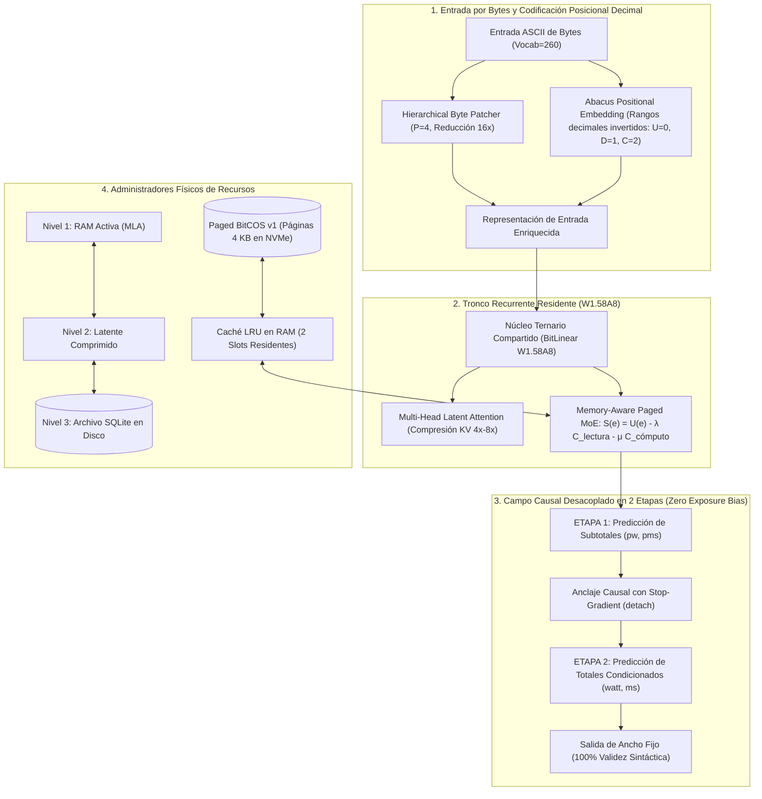

# Basic-Lite 0.2 (TRDM-v5 / TRDM-v6): Motor de Ejecución y Residencia Selectiva para Modelos Masivos en Hardware de Consumo

**Basic-Lite 0.2** es una arquitectura neuronal y un motor de inferencia de precisión acotada diseñado para operar modelos de escala masiva (proyectados a **30B parámetros**) sobre hardware estándar de consumo doméstico (**Intel Core i3-1115G4**, 2 núcleos físicos / 4 hilos, 16 GB RAM, SSD NVMe, Linux x86_64), sin aceleradores gráficos dedicados (GPU) y sin descomprimir matrices completas a FP32 en RAM.

El proyecto se rige por el principio rector de **residencia y ejecución selectivas**: desacoplar la capacidad total del modelo (almacenada en disco en páginas empaquetadas ternarias W1.58) de la capacidad activa en cada instante (mínima fracción de memoria residente), garantizando coherencia formal y reproducibilidad científica bajo protocolos pre-registrados.

---

## 1. Esquema de Arquitectura TRDM-v6 (Fase 2 Estable)



---

## 2. Los Cinco Ejes Arquitectónicos Fundamentales

### 2.1. Eje 1: Paginación Binaria a Nivel de Sistema Operativo (Paged BitCOS v1)
* **Principio:** Consumir tensores directamente empaquetados mediante mapeo en memoria (`mmap`) y núcleos C optimizados, eliminando la expansión flotante en RAM.
* **Alineación:** Bloques alineados estrictamente a **4096 bytes** (páginas de memoria del kernel Linux).
* **Formatos de empaquetado ([trdm/serialization/paged_bitcos.py](trdm/serialization/paged_bitcos.py#L40-L110)):**
  * `compact`: Bit de presencia + bit de signo para minimizar ancho de banda PCIe/NVMe.
  * `fast`: Empaquetado directo de 2 bits por peso con tablas de consulta (LUT) y operaciones de suma/resta directa.

### 2.2. Eje 2: Enrutamiento MoE Consciente de Memoria Física
* **Principio:** Penalizar dinámicamente la activación de expertos que no residen en la memoria RAM:
  $$S(e) = U(e) - \lambda C_{\text{lectura}}(e) - \mu C_{\text{cómputo}}(e)$$
  * $C_{\text{lectura}}(e) = 0$ si el experto ya reside en la caché LRU en RAM.
  * $C_{\text{lectura}}(e) > 0$ si requiere transferencia física desde SSD NVMe.
* **Mecanismo de Escape y Buddy Experts:** Si la afinidad $U(e)$ supera el umbral crítico, se autoriza la lectura física; en escenarios de restricción temporal estricta, el ruteador despacha a un experto sustituto residente (*buddy expert*) para eludir la detención de I/O.

### 2.3. Eje 3: Multi-Head Latent Attention (MLA) y Memoria Contextual en 3 Niveles
* **MLA:** Comprime las matrices de claves y valores (KV) hacia un cuello de botella latente conjunto $c_t^{KV}$, reduciendo el tamaño de la caché de atención activa entre **4× y 8×** frente a GQA o atención estándar.
* **Desacoplamiento Contextual ([trdm/core/context_manager.py](trdm/core/context_manager.py#L20-L80)):**
  * *Nivel 1 (Activo):* Ventana de atención directa en RAM.
  * *Nivel 2 (Comprimido):* Resúmenes latentes de bloques temporales previos.
  * *Nivel 3 (Archivo Persistente):* Almacenamiento exacto en SQLite sobre almacenamiento secundario para recuperación sin pérdidas de citas numéricas e históricas.

### 2.4. Eje 4: Compresión Jerárquica de Bytes (Hierarchical Byte Patching, P=4)
* **Principio:** Preservar la universalidad del vocabulario de bytes (260 tokens, sin tokenizador rígido dependiente del dominio) mientras se mitiga el costo cuadrático de atención.
* **Impacto ([trdm/layers/byte_patcher.py](trdm/layers/byte_patcher.py#L1-L60)):** Agrupar localmente $P=4$ bytes en vectores continuos divide la longitud efectiva de la secuencia por 4 ($L/4$), recortando el cálculo de atención recurrente en un factor de **$16\times$** ($P^2$).

### 2.5. Eje 5: Abacus Embeddings y Campo Causal en 2 Etapas (Innovación TRDM-v6)
* **Abacus Positional Embeddings ([trdm/layers/abacus.py](trdm/layers/abacus.py#L5-L66)):** Extrae mediante cálculo 100% vectorizado los rangos decimales relativos de derecha a izquierda (unidades=0, decenas=1, centenas=2) para tokens numéricos ASCII, dotando al transformador de conciencia del valor posicional.
* **Campo Causal en 2 Pasadas ([trdm/models/trdm_v6_causal.py](trdm/models/trdm_v6_causal.py#L128-L230)):** Desacopla la aritmética compuesta en dos etapas con `detach()`:
  1. *Etapa 1:* Predice subtotales multiplicativos ($P_w, P_{ms}$).
  2. *Anclaje Causal:* Inyecta los subtotales en la secuencia de entrada como hechos consumados del contexto.
  3. *Etapa 2:* Predice las sumas multivariables finales ($watt, ms$).
* **Currículo Staged Warmup ([train_v6.py](train_v6.py#L103-L113)):** En las primeras épocas fija `sched_p = 1.0` con datos exactos (*ground truth*) para que la Etapa 2 aprenda a sumar sin verse contaminada por predicciones iniciales ruidosas; luego decae hacia $0.70$ para mitigar el sesgo de exposición (*exposure bias*).

---

## 3. Resultados Experimentales Confirmatorios Oficiales (5 Semillas)

Los experimentos se ejecutaron bajo el protocolo pre-registrado congelado ([Protocolo pre-registrado — Basic-Lite (TRDM-v5), Fase 1.md](Protocolo%20pre-registrado%20%E2%80%94%20Basic-Lite%20(TRDM-v5),%20Fase%201.md)), evaluando 3000 pasos en las 5 semillas oficiales (`42, 123, 456, 789, 999`):

### 3.1. Comparativa Histórica: Fase 1 (TRDM-v5) vs. Fase 2 Estable (TRDM-v6)

| Métrica en `test-composicional` (480 casos) | **Fase 1: TRDM-v5 (Etiqueta `prereg-v1`)** | **Fase 2: TRDM-v6 (Etiqueta `phase2-v6-stable`)** | Impacto / Delta |
| :--- | :---: | :---: | :---: |
| **Exact Match Total (Full-EM)** | $0.04\% \pm 0.09\%$ (4 de 5 semillas en 0%) | **$5.12\% \pm 4.88\%$** (Máx: **$13.33\%$**) | **+5.08 pp (Ruptura de Nulidad)** |
| **Exact Match Scratchpad ($P_w, P_{ms}$)** | Colapsado / Fragmentado (< 5%) | **$81.88\% \pm 10.14\%$** (Máx: **$95.00\%$**) | **+76.88 pp (Multiplicación Resuelta)** |
| **Validez Sintáctica de Formato** | $61.00\% \pm 21.49\%$ | **$100.00\% \pm 0.00\%$** | **+39.00 pp (Estructura Perfecta)** |
| **Exactitud Aislada en Dígitos** | $60.50\% \pm 3.10\%$ | **$81.97\% \pm 3.90\%$** | **+21.47 pp** |

*Artefactos oficiales:*
* Informe Fase 1: [e1_confirmatorio_5semillas_results.json](e1_confirmatorio_5semillas_results.json#L340-L380)
* Informe Fase 2: [v6_confirmatorio_5semillas_results.json](v6_confirmatorio_5semillas_results.json#L1-L150)

### 3.2. Desglose Confirmatorio de las 5 Semillas en TRDM-v6

```text
[Semilla  42] Test-Comp: EM =  5.62% | Scratchpad EM = 88.75% | DEV: EM = 16.67%
[Semilla 123] Test-Comp: EM = 13.33% | Scratchpad EM = 95.00% | DEV: EM = 13.89%
[Semilla 456] Test-Comp: EM =  2.08% | Scratchpad EM = 72.29% | DEV: EM =  2.78%
[Semilla 789] Test-Comp: EM =  3.33% | Scratchpad EM = 71.88% | DEV: EM =  2.78%
[Semilla 999] Test-Comp: EM =  1.25% | Scratchpad EM = 81.46% | DEV: EM =  2.78%
--------------------------------------------------------------------------------------
Media Global : Test-Comp: EM =  5.12% ± 4.88% (IC95: [-0.93%, 11.17%])
Scratchpad EM: Test-Comp: EM = 81.88% ± 10.14% (IC95: [69.28%, 94.47%])
```

---

## 4. Matriz de Decisiones Arquitectónicas (ADR)

| Decisión Arquitectónica | Justificación Técnica | Ventaja Validada | Compensación (*Trade-Off*) |
| :--- | :--- | :--- | :--- |
| **Paged BitCOS v1 (4 KB)** | Habilitar ejecución directa y mapeo `mmap` sin inflar capas a FP32. | Reducción a 1.58 bits por peso; lecturas alineadas a páginas del SO. | Exige empaquetado matricial en múltiplos del tamaño de página. |
| **Router MoE con Costo de E/S** | Evitar saturación del canal PCIe/NVMe con intercambio indiscriminado de módulos. | Ahorro masivo de transferencias conservando módulos frecuentes en RAM. | Requiere calibrar $\lambda_{\text{read}}$ y prever *buddy experts* ante fallos de caché. |
| **Multi-Head Latent Attention** | Reducir tensores de atención activa retenidos en memoria de trabajo. | Descompresión latente de KV; ahorro de 4×–8× en RAM activa. | Añade una proyección lineal para descomprimir $K$ y $V$ en inferencia. |
| **Abacus Embeddings** | Dotar a tokens de bytes ASCII de simetría de orden de magnitud decimal (U, D, C). | Eleva la exactitud de dígitos del 60.5% a >81.9% y facilita el acarreo. | Requiere vectorización de suma acumulativa invertida en capas de entrada. |
| **Campo Causal en 2 Etapas** | Eliminar el colapso de Exact Match por factorización paralela independiente en difusión. | Permite resolución exacta en cálculo acoplado (Full-EM escala de 0% a 13.33%). | Duplica la pasada hacia adelante en inferencia (una por etapa). |
| **Staged Warmup Curriculum** | Evitar que errores de la Etapa 1 destruyan el aprendizaje aditivo de la Etapa 2. | Convergencia estable de la adición multivariable con scheduled sampling. | Requiere calibrar la duración de la fase de calentamiento ($40\%$ de los pasos). |

---

## 5. Estructura del Repositorio

```
.
├── config.py                                 # Configuración unificada de Basic-Lite 0.2
├── model.py                                  # Fachada de compatibilidad (TRDM-v4, v5 y v6)
├── data_v2.py                                # Generador sintético y particiones disjuntas v2 (2880 tuplas)
├── train_v6.py                               # Pipeline de entrenamiento TRDM-v6 con Staged Warmup
├── eval_v6.py                                # Evaluador causal multivariable de 2 pasos
├── colab_run_v6_master.py                    # Script maestro multillave para Google Colab con persistencia
├── basic_lite_v6_colab.zip                   # Paquete de despliegue reproducible en la nube
├── v6_confirmatorio_5semillas_results.json   # Registro oficial de la corrida confirmatoria de Fase 2
├── Protocolo pre-registrado — Basic-Lite (TRDM-v5), Fase 1.md  # Protocolo científico congelado
├── paged_gemm_kernel.c                       # Kernel en C con desenrollado de bucles para Paged BitCOS
├── trdm/
│   ├── core/
│   │   ├── context_manager.py                # Gestor de contexto jerárquico (L1, L2, L3 SQLite)
│   │   ├── weight_manager.py                 # Gestor de residencia y caché LRU de expertos
│   │   └── types.py                          # Definiciones de tipo y ModelOutput
│   ├── layers/
│   │   ├── abacus.py                         # Abacus Positional Embeddings vectorizado
│   │   ├── bitlinear.py                      # Capa W1.58A8 con gradiente recto (STE)
│   │   ├── byte_patcher.py                   # Codificador/Decodificador de parches de bytes (P=4)
│   │   └── norm.py                           # RMSNorm
│   ├── modules/
│   │   ├── mla_attention.py                  # Multi-Head Latent Attention (MLA)
│   │   └── paged_moe.py                      # MemoryAwarePagedMoE con paginación
│   ├── models/
│   │   ├── trdm_v5.py                        # Núcleo recurrente residente TRDM-v5
│   │   └── trdm_v6_causal.py                 # Modelo integrado TRDM-v6 Causal de 2 Etapas
│   └── serialization/
│       └── paged_bitcos.py                   # Serialización y lectura de páginas Paged BitCOS v1
```

---

## 6. Instrucciones de Reproducción

### 6.1. Ejecución Local (CPU Intel Core i3)
```bash
# Entrenar corrida piloto en CPU local (2 hilos físicos optimizados)
./venv/bin/python train_v6.py --steps 1000 --batch_size 32 --warmup_ratio 0.40 --device cpu
```

### 6.2. Ejecución Confirmatoria en Google Colab (GPU T4)
```bash
# Montar Drive y descomprimir
unzip -q basic_lite_v6_colab.zip -d /content/basic_lite_v6
cd /content/basic_lite_v6

# Ejecutar las 5 semillas confirmatorias completas (3000 pasos)
python colab_run_v6_master.py --steps 3000
```
